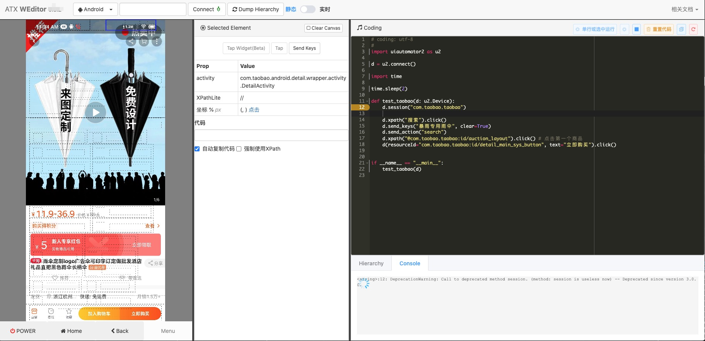

# Because it is difficult to reconstruct this project, I wrote a new one. Visit <https://uiauto.dev> and have a try

## WEditor
[](https://pypi.python.org/pypi/weditor)
[](https://github.com/alibaba/web-editor)
[](https://travis-ci.org/alibaba/web-editor)

[中文文档](README_ZH.md)

This project is subproject for smart phone test framework [openatx](https://github.com/openatx)
for easily use web browser to edit UI scripts.

Screenshot



## Installation
Dependencies

- Python3.6+
  - [airtest](https://github.com/AirtestProject/Airtest) (Android)
  - [facebook-wda](https://github.com/openatx/facebook-wda) (iOS)


> Only tested in `Google Chrome`, _IE_ seems not working well.

```
pip3 install -U weditor
```

For developers

```bash
git clone https://github.com/openatx/weditor
pip3 install -e weditor
```

## Usage
Start the server with the module entry and an optional workspace folder:

```
python -m weditor2 --workspace D:\work\myproject
```

`--workspace` sets the root folder for file operations. Omit it to use the
current working directory. The editor's 打开 / 保存 / 新建 actions work with
relative paths under this folder; 保存 writes back to the already-opened local
file (it never downloads a copy).

Create Shortcut in Desktop (Only windows)

```
weditor --shortcut
```

The shortcut launches `python -m weditor2`. You can also start directly with:

```
python -m weditor2
```

This starts a local server on port 17310 and opens a browser tab for editing.
Port 17310 memorizes the created day -- 2017/03/10.

To see more usage run `python -m weditor2 -h`.

The older `python -m server` and `python -m weditor` commands still work.

## Hotkeys(Both Mac and Win)
- Right click screen: `Dump Hierarchy`

### Hotkeys(only Mac)
- Command+Enter: Run the whole code
- Command+Shift+Enter: Run selected code or current line if not selected

### Hotkeys(only Win)
- Ctrl+Enter: Run the whole code
- Ctrl+Shift+Enter: Run selected code or current line if not selected

## For Developers
See [DEVELOP.md](DEVELOP.md)

## LICENSE
[MIT](../LICENSE)
